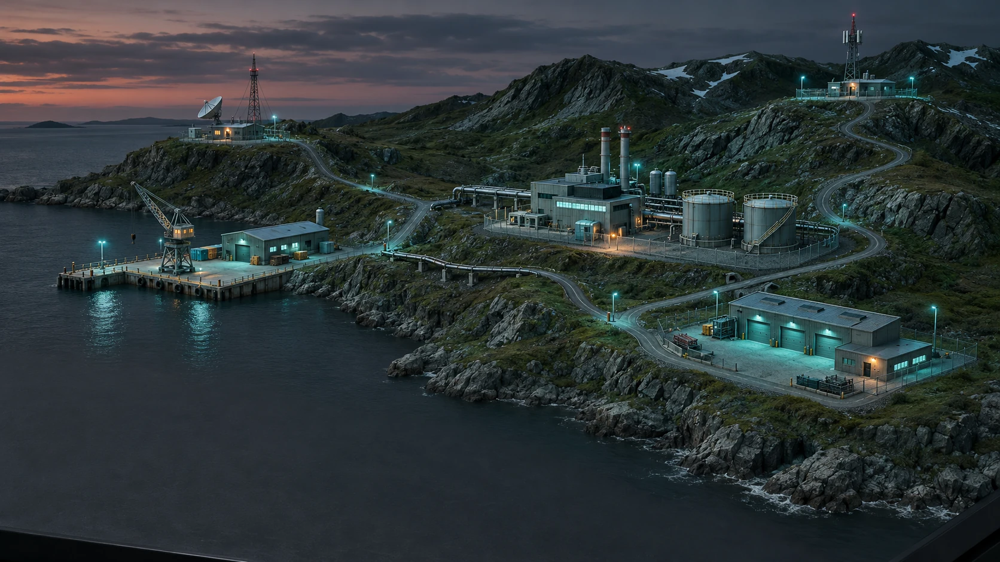
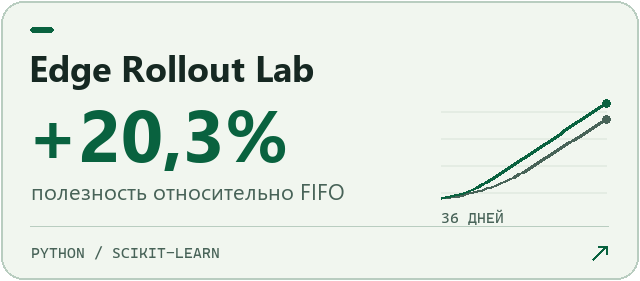
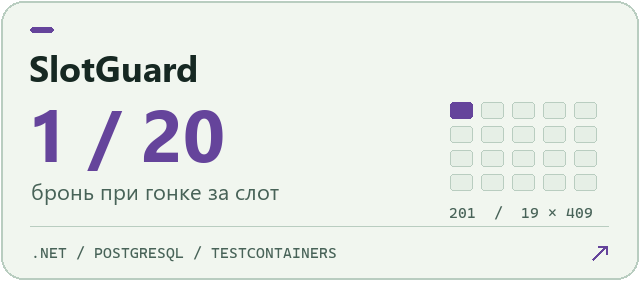
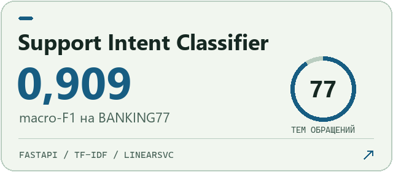
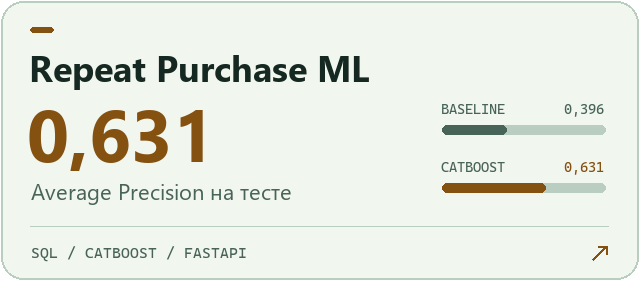

# 14:03 · Окно обслуживания

Два запроса на последний слот. Пять площадок ждут обновления.

**[Войти в сцену](https://npapahaha.github.io/npapaHAHA/)** · 1 минута

Егор · ИТМО · прикладной ML и бэкенд

## Проекты

  <a href="https://github.com/npapaHAHA/edge-rollout-lab"><picture>
    <source media="(prefers-color-scheme: dark)" srcset="https://raw.githubusercontent.com/npapaHAHA/npapaHAHA/main/assets/profile/edge-dark.png">
    
  </picture></a>
  <a href="https://github.com/npapaHAHA/SlotGuard"><picture>
    <source media="(prefers-color-scheme: dark)" srcset="https://raw.githubusercontent.com/npapaHAHA/npapaHAHA/main/assets/profile/slotguard-dark.png">
    
  </picture></a>

  <a href="https://github.com/npapaHAHA/support-intent-classifier"><picture>
    <source media="(prefers-color-scheme: dark)" srcset="https://raw.githubusercontent.com/npapaHAHA/npapaHAHA/main/assets/profile/support-dark.png">
    
  </picture></a>
  <a href="https://github.com/npapaHAHA/repeat-purchase-ml"><picture>
    <source media="(prefers-color-scheme: dark)" srcset="https://raw.githubusercontent.com/npapaHAHA/npapaHAHA/main/assets/profile/retail-dark.png">
    
  </picture></a>

Как получены результаты

- **Edge Rollout Lab.** Сравнение с FIFO по суммарной полезности за 36 дней. Среднее пяти прогонов на синтетических данных. [Бенчмарк](https://github.com/npapaHAHA/edge-rollout-lab#benchmark-results)
- **SlotGuard.** Интеграционный тест параллельного бронирования. Один ответ HTTP 201 и 19 ответов HTTP 409. [Локальное демо](https://github.com/npapaHAHA/SlotGuard#быстрый-запуск)
- **Support Intent Classifier.** TF-IDF + LinearSVC на 3 071 отложенном обращении. [Отчёт об оценке](https://github.com/npapaHAHA/support-intent-classifier/blob/main/metrics.json)
- **Repeat Purchase ML.** Признаки в SQL за 90 дней, модель CatBoost и тест на более поздних данных. [Отчёт об оценке](https://github.com/npapaHAHA/repeat-purchase-ml/blob/main/metrics.json)

